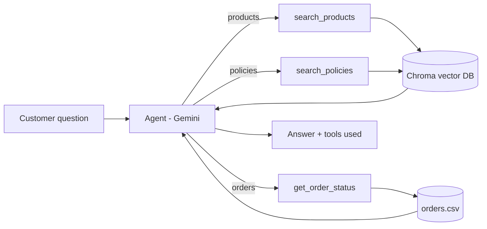

# 🛍️ ShopFlow Agent

ShopFlow Agent is an AI-powered conversational shopping assistant that combines
Retrieval-Augmented Generation (RAG) with tool-calling agents to answer product,
policy, and order-related queries using a demo e-commerce store's own data.

The system uses LangChain and the Gemini API to understand user queries and
route them to the appropriate tool. Product and policy information is embedded
and stored in ChromaDB, allowing the assistant to retrieve relevant information
and generate responses grounded in the store's data. It also supports
metadata-based price filtering for budget-related product queries and includes
a fallback when the requested information cannot be found.

> The store in this project, VoltKart, is not real. The products, policies and
> orders in `data/` are made up for the demo.

## Tech Stack

Python · LangChain · Gemini API · ChromaDB · RAG · Tool-Calling Agents · Streamlit

## What it can do

- 🔎 **Product Search**: finds relevant products from the store catalogue.
- 📋 **Policy Search**: answers questions about store policies using retrieved documents.
- 📦 **Order Lookup**: retrieves the status of an order from its order ID.
- 💰 **Price Filtering**: filters products based on budget requirements.
- 🧠 **Agentic Tool Selection**: decides which tool is appropriate for the user's query.
- 📚 **Grounded Responses**: generates answers from retrieved store data, not from the model's general knowledge.
- ⚠️ **Not-Found Fallback**: says so when the relevant information is not in the store data.
- 💬 **Streamlit Interface**: provides a conversational chat experience with memory of earlier turns.

## Example questions

| Question | Tool used | Answered from |
|---|---|---|
| "Wireless earbuds under Rs. 3000" | `search_products` | Product catalogue (30 products) |
| "Can I return a laptop?" | `search_policies` | Policy document |
| "Where is my order ORD1002?" | `get_order_status` | Orders file |

## How it works



1. **Indexing (once).** Each product becomes one document. The policy text is
   split into chunks of 500 characters with an 80-character overlap. Both are
   embedded with `gemini-embedding-001` and stored in Chroma.
2. **Retrieval.** A question is embedded and Chroma returns the closest
   documents.
3. **Generation.** Gemini answers using only the retrieved text, and says so
   when the answer is not in the data.
4. **Agent.** The model chooses between three tools: product search (with an
   optional price filter), policy search and order lookup.

### Why a price filter

Embeddings capture meaning, not numbers, so a plain similarity search for
"earbuds under 1500" can return products above the budget. The product search
tool therefore accepts a `max_price` argument and applies it as a metadata
filter in Chroma.

## Project structure

| File | Purpose |
|---|---|
| `step1_llm.py` | Calls the LLM directly, without any store data |
| `step2_build_index.py` | Chunks, embeds and stores the data in Chroma |
| `step3_rag.py` | Plain RAG: retrieve, add to the prompt, generate, show sources |
| `step4_agent.py` | Tool-calling agent with three tools |
| `app.py` | Streamlit chat interface for the agent |
| `config.py` | Model names, paths and shared helpers |
| `data/` | Products, store policies and orders |

## Setup

Requires Python 3.11 or newer and a Gemini API key from Google AI Studio
(https://ai.google.dev/gemini-api/docs/api-key).

```
python -m venv .venv
.venv\Scripts\activate          (Windows)
source .venv/bin/activate       (Mac / Linux)
pip install -r requirements.txt
```

Copy `.env.example` to `.env` and put your key in it:

```
GOOGLE_API_KEY=your-key
```

## Run

```
python step2_build_index.py     # build the vector database (once)
streamlit run app.py            # open the chat page
```

`step3_rag.py` and `step4_agent.py` run the same logic in the terminal.

## Limitations

- The data is small and synthetic.
- Orders are looked up by ID only. There is no login, so a real system would
  need to verify the customer first.
- There is no automated evaluation yet.
- Every question needs calls to the Gemini API, so the free-tier rate limits
  apply.

## Possible improvements

- A test set of questions with expected answers and tools, to measure accuracy.
- A FastAPI endpoint so other applications can call the assistant.
- Hybrid search (keywords + embeddings) for product names and model numbers.
